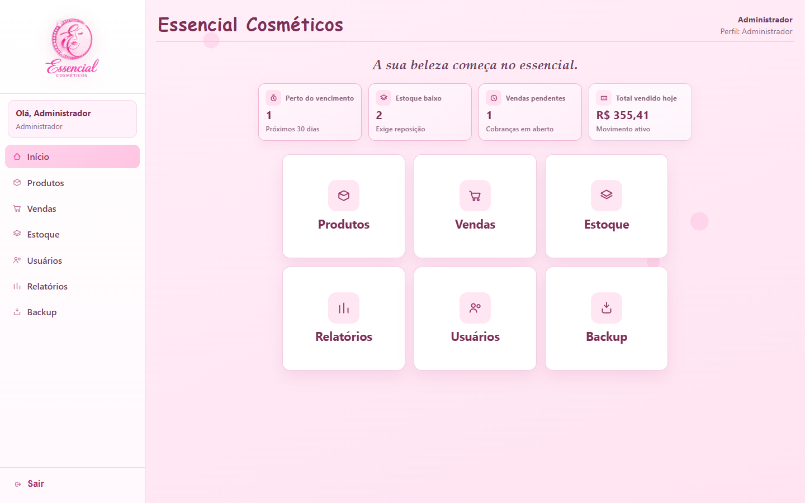
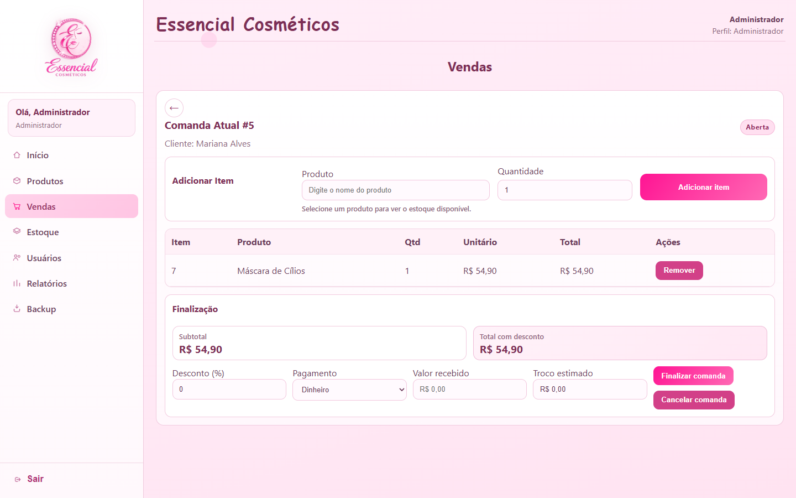
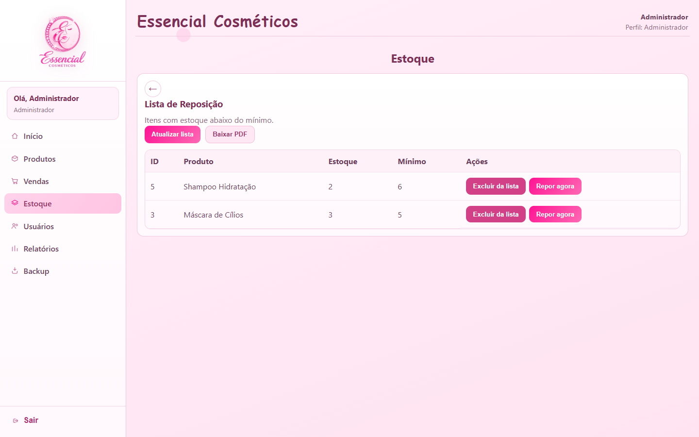
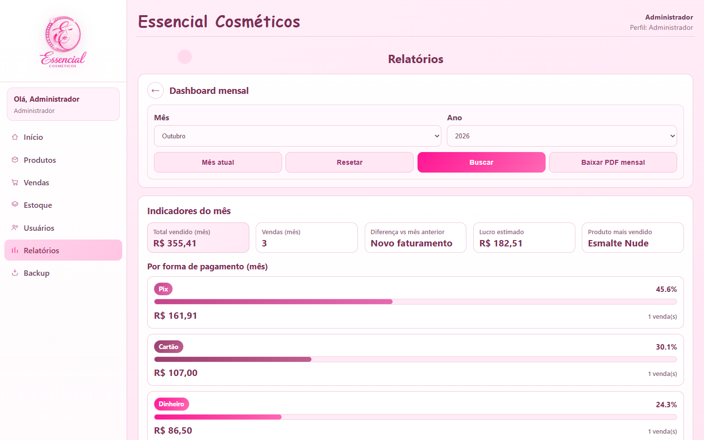

# Essencial Cosméticos — PDV e Controle de Estoque

Sistema desktop de ponto de venda desenvolvido para a loja Essencial Cosméticos e **em uso no dia a dia da loja**. Ele substitui o controle em caderno/planilha: registra as vendas por comanda, baixa o estoque automaticamente, controla vendas a prazo (fiado), fecha o caixa do dia e gera relatórios mensais em PDF.



## Funcionalidades

**Vendas**
- Comanda por cliente: adiciona e remove itens, aplica desconto (máx. 50%) e finaliza em dinheiro, Pix, cartão ou a prazo
- Cálculo de troco no pagamento em dinheiro
- Comandas que ficaram abertas (ex: o app foi fechado no meio da venda) podem ser retomadas
- Venda a prazo baixa o estoque na hora, mas só entra no caixa quando é paga
- Histórico de vendas paginado

**Estoque**
- Cadastro de produtos com preço de custo, preço de venda, estoque mínimo e validade
- Entrada e ajuste de estoque, sempre registrando o movimento (`stock_movements`)
- Lista de reposição gerada a partir do estoque mínimo, com exportação em PDF
- Alerta de produtos perto do vencimento

**Caixa e relatórios**
- Resumo do dia por forma de pagamento e fechamento de caixa (bloqueia novas vendas até o admin reabrir)
- Dashboard mensal com comparação com o mês anterior, lucro estimado e produto mais vendido
- Relatório mensal em PDF

**Acesso e segurança**
- Login com JWT e dois perfis: `ADMIN` e `FUNCIONARIO`
- Funcionário não vê preço de custo/lucro e só acessa as próprias vendas
- Senhas com hash bcrypt
- Backup automático diário do banco e backup manual pela tela

## Telas

| Comanda | Reposição | Relatório mensal |
| --- | --- | --- |
|  |  |  |

## Tecnologias

| Camada | Tecnologias |
| --- | --- |
| Frontend | React 19, React Router, Axios, Vite, CSS puro |
| Backend | Node.js, Express 5, JWT, bcrypt, PDFKit |
| Banco | SQLite (modo WAL) |
| Desktop | Electron + electron-builder (instalador Windows) |
| Qualidade | Testes de integração com `node:test`, ESLint e Prettier |

## Arquitetura

```
essencial-cosmeticos/
├── backend/
│   ├── src/
│   │   ├── routes/         # endpoints e permissões por perfil
│   │   ├── controllers/    # lê a requisição e devolve a resposta HTTP
│   │   ├── services/       # regras de negócio (estoque, desconto, caixa...)
│   │   ├── repositories/   # SQL
│   │   ├── middlewares/    # autenticação, autorização e tratamento de erros
│   │   ├── database/       # schema.sql e seeds
│   │   └── shared/         # AppError, validações, datas
│   └── tests/              # testes de integração da API
├── frontend/src/
│   ├── pages/              # uma página por módulo
│   ├── components/         # menu, cards, paginação, toasts
│   ├── context/            # sessão do usuário (AuthContext)
│   └── utils/              # formatação de moeda, datas e rótulos
├── electron/main.js        # sobe o backend e abre a janela do app
└── docs/screenshots/
```

O backend segue o fluxo `rota → controller → service → repository`. Toda regra de negócio fica no service, e o repository só executa SQL. A documentação dos endpoints está em [backend/README.md](backend/README.md).

No app instalado, o Electron sobe o Express dentro do próprio processo e o mesmo servidor entrega o build do React. O banco e os backups ficam na pasta de dados do usuário do Windows.

## Como rodar

Pré-requisito: Node.js 22 ou superior.

```bash
# 1. Instalar as dependências (raiz, backend e frontend)
npm run install:all

# 2. Configurar o backend
cp backend/.env.example backend/.env   # e preencha o JWT_SECRET

# 3. (Opcional) Criar produtos e vendas de exemplo
npm --prefix backend run seed:demo

# 4. Subir a API (http://localhost:3000/api) e o frontend (http://localhost:5173)
npm run dev:backend
npm run dev:frontend
```

Na primeira execução são criados dois usuários:

| Perfil | Email | Senha |
| --- | --- | --- |
| Admin | `admin@essencial.com` | `admin123` |
| Funcionário | `funcionario@essencial.com` | `func123` |

### App desktop

```bash
npm run electron:prod-preview   # abre o app como se estivesse instalado
npm run dist                    # gera o instalador em release/
```

## Testes

```bash
npm test
```

Os testes sobem a API de verdade em um banco SQLite temporário e cobrem os fluxos principais: login e permissões, cadastro de usuários, ocultação do preço de custo, entrada/ajuste de estoque, venda com troco, venda a prazo, fechamento de caixa e cenários de erro (estoque insuficiente, desconto inválido, finalizar a mesma comanda duas vezes ao mesmo tempo).

## Decisões técnicas

- **Transação com conexão própria.** A finalização de venda baixa o estoque de vários produtos de uma vez. Rodar `BEGIN/COMMIT` na conexão compartilhada não funciona bem: comandos de outras requisições podem cair dentro da mesma transação, e um `ROLLBACK` desfaz o trabalho delas também. Por isso cada transação abre a sua própria conexão com `BEGIN IMMEDIATE` (`withTransaction` em `config/database.js`). Um dos testes dispara duas finalizações da mesma comanda ao mesmo tempo para garantir que o estoque só é baixado uma vez.
- **Custo congelado no item da venda.** `sale_items.purchase_price_snapshot` guarda o custo do produto no momento da venda, então o lucro de meses anteriores não muda quando o custo é atualizado.
- **Data do caixa pelo pagamento.** Os relatórios usam `settled_at` (quando o dinheiro entrou), não a data da venda. Assim uma venda a prazo feita em março e paga em abril entra no caixa de abril.
- **Horário local.** As datas do caixa são geradas no fuso local. Usar `toISOString()` (UTC) fazia vendas depois das 21h caírem no dia seguinte.
- **API sob `/api`.** Algumas telas do React têm o mesmo caminho de endpoints (`/products`, `/users`). Com o prefixo, recarregar a página no app desktop abre a tela em vez de devolver o JSON da API.

## Próximos passos

- Testes de componentes no frontend (React Testing Library)
- Dividir `Sales.jsx` e `Stock.jsx` em componentes menores
- Leitor de código de barras na comanda
- Limpeza automática de backups antigos

## Autor

Desenvolvido por **Ricardo Mendes Lima** · [github.com/Ricardospadetto03](https://github.com/Ricardospadetto03)
